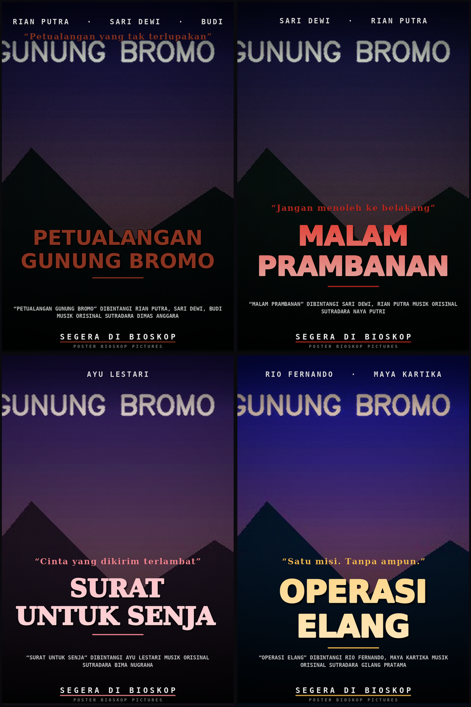
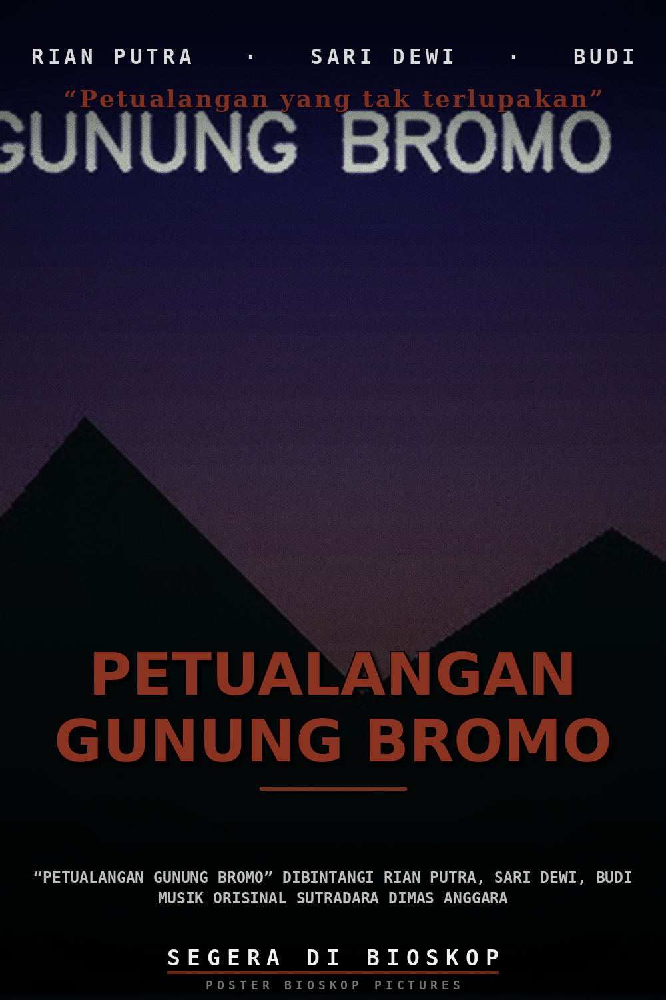
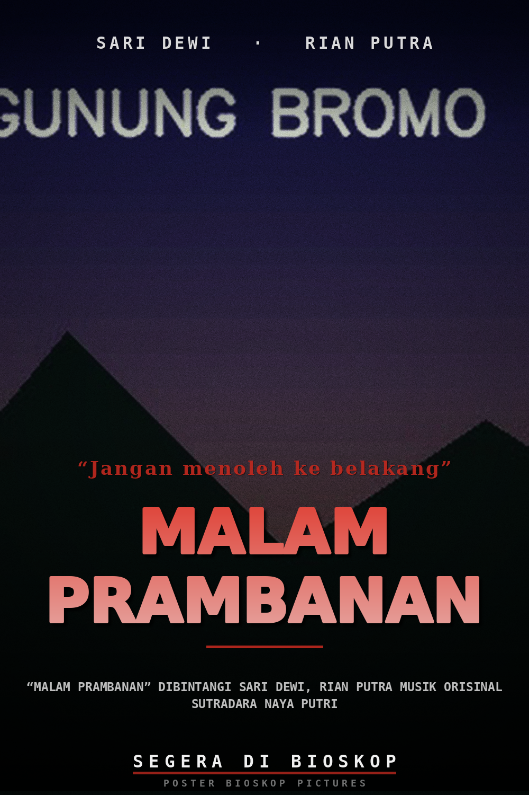
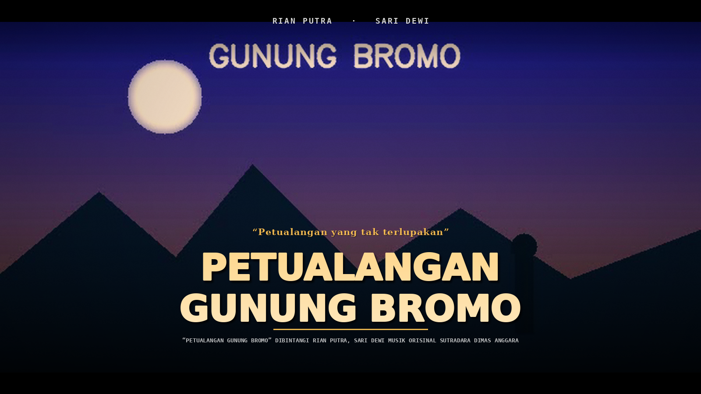

# 🎬 PosterBioskopAI

**Ubah video/foto biasa jadi poster film ala Hollywood — 100% offline, tanpa internet, tanpa API key.**



Aplikasi desktop (Python + Tkinter) untuk pembuat konten, pelajar, dan pemilik usaha
cetak banner yang ingin poster bergaya poster bioskop tanpa perlu belajar desain.

## Cara kerja

1. **Pilih video atau foto** — aplikasi mengekstraksi *frame terbaik* otomatis
   (skor ketajaman + exposure + kontras), lalu menebak **judul, tagline, nama
   pemeran, dan sutradara** langsung dari nama file.
   `VID_20240102_petualangan_gunung_bromo.mp4` → judul **"Petualangan Gunung Bromo"** ✨
2. **Auto-match gaya** — frame dianalisis (kecerahan, suhu warna, saturasi, mood)
   lalu dicocokkan ke salah satu dari **999 referensi gaya** yang tersimpan di
   `style_library.py`, lengkap dengan alasan pencocokan. Kurang sreg? Buka
   **Galeri** dan pilih manual — ada filter genre/era, pencarian, dan preview
   posternya langsung jadi.
3. **Render final** — color grading sinematik per genre, tipografi ala poster
   bioskop (judul auto-fit 1–2 baris, tagline, billing block, strip rilis),
   vignette, bloom, grain, dan letterbox — dalam **4 rasio**:
   Poster 2:3 · Potret 3:4 · Kotak 1:1 · Wallpaper 16:9.



## Instalasi (Windows)

1. **Paling gampang — tanpa install apa pun:** buka halaman
   [Releases](https://github.com/zacrie85/PosterBioskopAI/releases) dan unduh
   `PosterBioskopAI.exe` (dibangun otomatis oleh GitHub Actions di Windows asli).
2. Atau pakai Python: install [Python 3.9+](https://www.python.org/downloads/)
   (centang *Add to PATH*), lalu di Command Prompt:
   ```
   pip install -r requirements.txt
   python poster_app.py
   ```
3. Ingin file `.exe` yang bisa dibuka tanpa Python? Jalankan `build_windows.bat`
   → hasilnya di `dist\PosterBioskopAI.exe`.

Di Linux/macOS langkahnya sama; font Judul memakai Impact/Arial Black bawaan
Windows, atau otomatis fallback ke DejaVu/Liberation di sistem lain.

## Mode batch — satu folder, banyak poster

Butuh poster untuk 30 video sekaligus? Pakai **MODE BATCH**:

- **Dari aplikasi:** klik **📦 Batch: Pilih Folder & Buat Semua…** di panel kiri.
  Pilih folder berisi video/foto → tiap file dianalisis sendiri (frame terbaik,
  judul dari nama file, auto-match gaya) → semua poster tersimpan di folder
  `<nama-folder>_poster` di sebelah folder sumber. Ada progress bar, log, dan
  tombol Batal.
- **Dari terminal / tanpa GUI:**
  ```
  python batch_poster.py "D:\video-kegiatan" --rasio "Wallpaper 16:9"
  python batch_poster.py folder --gaya REF-289 --out hasil
  ```
  (`--gaya` = pakai SATU referensi untuk semua file; tanpa itu = auto-match per
  file. `--out` = folder hasil kustom.)

## Contoh hasil

| Horor (grading dingin) | Wallpaper 16:9 (letterbox) |
| --- | --- |
|  |  |

Coba langsung: folder `contoh/` berisi video uji
`VID_20240102_petualangan_gunung_bromo.avi` — muat di aplikasi dan poster jadi
dalam hitungan detik.

## Struktur proyek

| File | Isi |
| --- | --- |
| `poster_app.py` | GUI aplikasi (Tkinter) |
| `batch_poster.py` | Mode batch: folder → banyak poster (juga CLI) |
| `poster_engine.py` | Mesin render: grading, tipografi, efek |
| `style_library.py` | 999 referensi gaya + mesin auto-match |
| `frame_picker.py` | Ekstraksi frame terbaik + judul dari nama video |
| `build_windows.bat` | Build EXE (PyInstaller) |
| `.github/workflows/` | Build EXE otomatis di runner Windows GitHub |
| `rilis_github.bat` | Upload proyek ini ke repo GitHub-mu |
| `contoh/` | Video uji + contoh poster |

## Lisensi

MIT — bebas dipakai dan dimodifikasi. Poster dibuat dari foto/video milikmu sendiri.
